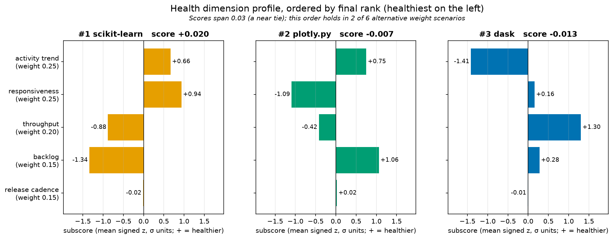
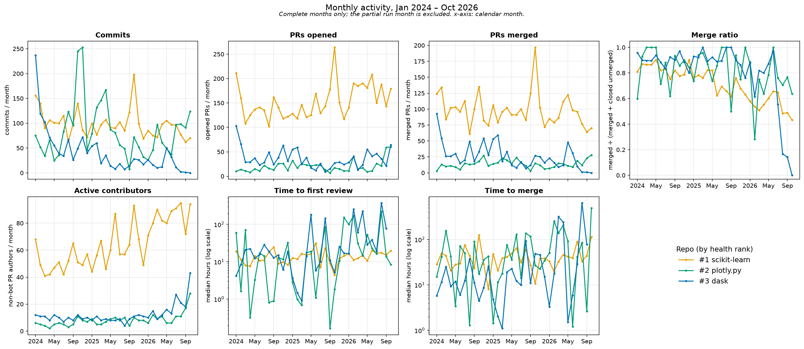
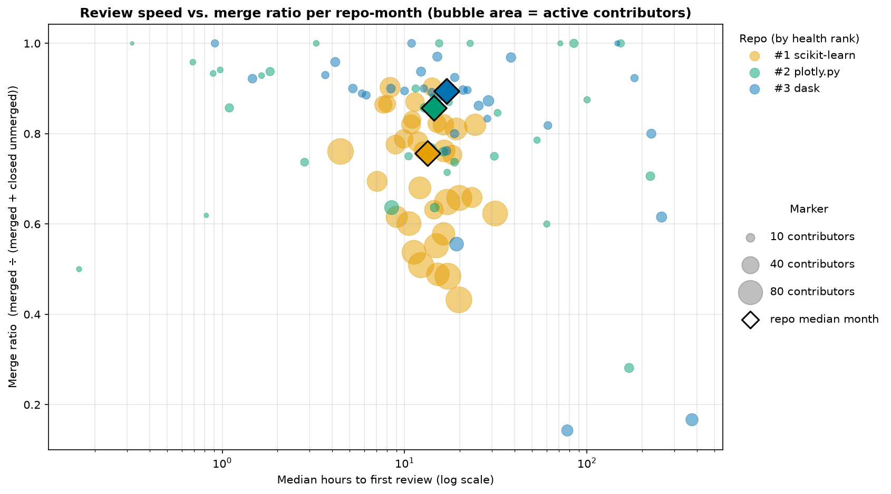

# DP2: Open Source Package Health Pipeline

DS3022 Data Project 2 · Package set **B** · Flow `bxp6yd-package-health-flow`

The assignment brief and grading rubric are in this repository's git history (the original template README).
The submission checklist is in [CHECKLIST.md](CHECKLIST.md).

## Overview

`main.py` defines one Prefect flow that runs six tasks in order:

| # | Task | What it does | Output |
|---|---|---|---|
| 1 | `1-extract` | Pulls commits and releases from the GitHub REST API, and pull requests and PR reviews from the GraphQL API | `data/raw/<owner>__<repo>/<endpoint>/page_NNNN.json` |
| 2 | `2-load` | Upserts every landed record into one raw table per endpoint | `packages.duckdb` (`raw_*`, `_load_state`) |
| 3 | `3-dbt-build` | Runs `dbt build`: 4 staging models, 2 fact models, 2 marts, plus tests | staging/fact/mart tables |
| 4 | `4-validate` | Python checks from files to raw to staging, outlier scan, descriptive statistics | logs only (raises on failure) |
| 5 | `5-model` | Signed z-scores, five dimension subscores, weighted health score, ranking, weight sensitivity | `health_ranking` table |
| 6 | `6-plot` | Dimension profile, monthly trends, relationship plot | `plots/*.png` |

Repositories (set B): `scikit-learn/scikit-learn`, `dask/dask`, `plotly/plotly.py`. Analysis window: 2024-01-01 through the run time.

**Result (clean-clone run, 2026-11-02):** scikit-learn ranks 1st (+0.022), plotly.py 2nd (−0.003), dask 3rd (−0.019).
This is a near tie. The three scores fall within 0.041 of each other on a z-score scale, and the chosen order
holds in only 2 of 6 alternative weight scenarios. See [Sensitivity](#sensitivity-and-the-near-tie).

**Which run the numbers come from.** Every analysis number in this README (Tasks 2–5: row counts, outliers, descriptive
statistics, metrics, scores, ranking, sensitivity), the plot captions and the committed `plots/*.png` come from the
**2026-11-02 clean-clone run**, which used the REST extract. The extended items (GraphQL, concurrency, deployment) were
added afterwards, and their sections use their own runs. A GraphQL full run on 2026-11-04, two days later, swapped
places 2 and 3 (dask 2nd at 0.00, plotly 3rd at −0.02): live evidence of the near tie, not an effect of the API change
(see [GraphQL ingestion](#graphql-ingestion)).

## Setup and run

Requirements: Python 3.12, [uv](https://docs.astral.sh/uv/), and a GitHub personal access token.

```bash
git clone https://github.com/Mattcben1/DP2.git && cd DP2
uv venv --python 3.12
source .venv/bin/activate
uv pip install -r requirements.txt        # every dependency pinned (prefect 3.9.0, dbt-core 1.12.6, dbt-duckdb 1.11.1, duckdb 2.0.0, ...)
export GH_PAT=<your token>                # read only from the environment; never logged or written to disk
prefect profile use uvasds                # after adding the course profile snippet (from Canvas) to ~/.prefect/profiles.toml
python main.py
```

- **Prefect.** Point Prefect at the course server with `prefect profile use uvasds`, after adding the course profile
  snippet (from Canvas) to `~/.prefect/profiles.toml`. The snippet's auth string is not reproduced here.
- **Token.** `_github_headers()` reads `GH_PAT`. If it is not set, it falls back to the Prefect Secret block
  `bxp6yd-pat` (used by the deployment), and raises a clear error if neither is available. It logs which source it used,
  never the value. No token is in the repository.
- **dbt.** `dbt_project.yml` and `profiles.yml` are at the repo root, and Task 3 passes both as the project and
  profiles directory. You don't need a `~/.dbt` setup.
- **Dev mode.** `DEV_MODE` at the top of `main.py` switches to a 2026-01-01 start and `dask/dask` only.
  It is `False` for the submitted full run.
- **Ingestion mode.** `INGESTION = "graphql"` (default) fetches pull requests and reviews through GraphQL;
  `"rest"` switches back to the REST endpoints. Commits and releases always use REST.
- **Concurrency.** `EXTRACT_WORKERS = 3` fetches the three repos in parallel; `1` runs them one after another through
  the same code.
- **Outputs.** `data/`, `packages.duckdb`, `logs/` and `.venv` are git-ignored. `plots/` is committed.

**Expected runtime**

| Run | Runtime | Evidence |
|---|---|---|
| Full run from a clean clone (empty `data/`, no database), `INGESTION = "graphql"` | **~4–5 min** (4 min 18 s logged), no rate-limit wait | full GraphQL run 2026-11-04 |
| Full run, `INGESTION = "rest"` | **~1.5 h** (1 h 32 min logged, 17:59:38 → 19:32:06), including one 1,099 s rate-limit sleep | clean-clone run 2026-11-02 |
| Incremental run (database and `_LOADED` present) | **~45 s** (41 s and 44 s logged) | runs 2026-11-02 00:27 and 12:00 |

In REST mode most of the full run is the per-PR review calls (7,140 of 7,309 pages) plus waiting for the hourly rate
limit to reset. GraphQL removes those calls, which is why the default full run takes minutes
(see [GraphQL ingestion](#graphql-ingestion)).

**Logging.** Each task logs through the Prefect logger and to its own file. The files are `logs/extract.log`, `load.log`,
`dbt_build.log`, `validate.log`, `model.log`, `plot.log` and `flow.log`. dbt's own log is saved as `logs/dbt.log`.

## Task 1: Extraction

This section describes the REST extract, and its log excerpts come from the REST runs (the 2026-11-02 clean clone and
the 2026-10-28 interrupted run). With the default `INGESTION = "graphql"`, PRs and reviews come from GraphQL instead,
with the same landing layout, window rules and resume logic; see [GraphQL ingestion](#graphql-ingestion). Repos are
fetched in parallel; see [Concurrent fetching](#concurrent-fetching).

**Endpoints** (per repo, all with `per_page=100`):

| Endpoint | Request | Window restriction |
|---|---|---|
| Commits | `GET /repos/{r}/commits?since=<watermark or 2024-01-01>` | `since` |
| Pull requests | `GET /repos/{r}/pulls?state=all&sort=updated&direction=desc` | stop paginating once a page ends before the watermark (`_stop_before`) |
| PR reviews | `GET /repos/{r}/pulls/{n}/reviews` | one call per PR **created** in the window, merged or not, and updated since the watermark (`_review_targets`) |
| Releases | `GET /repos/{r}/releases` | fetched in full (small) |

**Pagination.** `fetch_page` returns the `rel="next"` URL from the `Link` header (`response.links`), and `_paginate` follows it
until there is none. Record and page counts are logged per endpoint per repo. From the clean-clone run:

```
2026-11-02 19:03:04,835 | INFO | scikit-learn/scikit-learn commits: 3351 records (34 pages fetched, 0 pages skipped from disk)
2026-11-02 19:03:04,839 | INFO | scikit-learn/scikit-learn pulls: 6400 records (64 pages fetched, 0 pages skipped from disk)
2026-11-02 19:03:04,842 | INFO | scikit-learn/scikit-learn releases: 51 records (1 pages fetched, 0 pages skipped from disk)
2026-11-02 19:03:04,843 | INFO | scikit-learn/scikit-learn reviews: 18296 records (5225 pages fetched, 0 pages skipped from disk)
2026-11-02 19:12:03,828 | INFO | dask/dask commits: 1371 records (14 pages fetched, 0 pages skipped from disk)
2026-11-02 19:12:03,830 | INFO | dask/dask pulls: 1500 records (15 pages fetched, 0 pages skipped from disk)
2026-11-02 19:12:03,832 | INFO | dask/dask releases: 44 records (1 pages fetched, 0 pages skipped from disk)
2026-11-02 19:12:03,836 | INFO | dask/dask reviews: 1985 records (1226 pages fetched, 0 pages skipped from disk)
2026-11-02 19:29:04,057 | INFO | plotly/plotly.py commits: 2827 records (29 pages fetched, 0 pages skipped from disk)
2026-11-02 19:29:04,064 | INFO | plotly/plotly.py pulls: 900 records (9 pages fetched, 0 pages skipped from disk)
2026-11-02 19:29:04,069 | INFO | plotly/plotly.py releases: 109 records (2 pages fetched, 0 pages skipped from disk)
2026-11-02 19:29:04,076 | INFO | plotly/plotly.py reviews: 1592 records (689 pages fetched, 0 pages skipped from disk)
2026-11-02 19:29:04,198 | INFO | Extract finished: 7309 pages fetched this run (7311 requests sent, retries included)
```

**Primary rate limit.** The shared `RateLimiter` (hooked into the httpx client) reads `X-RateLimit-Remaining` and
`X-RateLimit-Reset` on every response. When 25 or fewer requests remain (`RATE_LIMIT_BUFFER`), every worker sleeps until
the reset time plus a 5 s margin, so the budget never reaches zero. A REST full run needs more than 5,000 requests, so it
always hits this sleep (a GraphQL full run needs about 200 and never does):

```
2026-10-28 21:59:28,189 | WARNING | Only 25 requests left: sleeping 1551 s until the rate limit resets
2026-11-02 18:41:24,984 | WARNING | Only 25 requests left: sleeping 1099 s until the rate limit resets
```

The first line is from the 2026-10-28 full run and the second from the clean-clone run. Both predate the shared limiter;
its warning now reads "Only N core requests left: all workers sleeping ... s".

**Retries and other HTTP errors.** `fetch_page` (REST) and `fetch_graphql` are Prefect tasks with `retries=4`,
`retry_delay_seconds=exponential_backoff(backoff_factor=10)` (10, 20, 40, 80 s) and `retry_jitter_factor=0.5`. Both
check responses with `_check_response`. Waits go through the shared limiter, so every worker pauses, not just the one
that got the error:
- 403/429 with `Retry-After`: all workers pause that many seconds, then retry.
- 403 with `Remaining: 0`: the retry waits for the reset in the limiter's request hook.
- 429 or a "secondary rate limit" message without `Retry-After`: all workers pause 60 s, then retry.
- GraphQL only: GitHub reports most errors with HTTP 200 and an `errors` list. `RATE_LIMITED` pauses 60 s and retries,
  server-side failures ("something went wrong", timeouts) are retried, anything else raises without a retry.
- 5xx, network errors (`httpx.TransportError`) and unparseable JSON: raise `TransientHTTPError`, which is retried.
- Any other status (401, 404, 422): logged with the URL and the start of the response body, then raised as a
  non-retryable `RuntimeError`. `_retry_if_transient` is the `retry_condition_fn`, so retrying never wastes quota on
  errors that won't go away.

Retry in practice (clean-clone run): the odometer recorded **2 requests with no response** out of 7,311. The Prefect console
showed `fetch-page-e20` going `AwaitingRetry → Retrying` (run count 2) at 19:25, and the run completed. The Prefect
`EventsWorker` errors at 18:21 and 19:25 come from the client reporting status to the Prefect server. They are not pipeline errors.

```
2026-11-02 19:32:06,112 | INFO | API odometer: 7311 GitHub API requests this flow run (by status: 200: 7309; no response: 2)
```

**Resume or start fresh.** At the start of each run, Task 1 checks for `data/raw/_LOADED`:
- Present: everything on disk is already in DuckDB. Task 1 deletes `data/raw/` and fetches only what changed since the
  `_load_state` watermarks.
- Absent: the previous run stopped early. Task 1 keeps the files, and for each endpoint `_paginate` walks the pages
  already on disk and continues from the last page's saved `next_url` (`_paginate_graphql` does the same with
  `next_cursor`). Resuming from pages landed in the other `INGESTION` mode is refused (`_check_mode`).

The first full run (2026-10-28) was interrupted with Ctrl-C partway through the scikit-learn reviews:

```
2026-10-28 21:20:33,518 | INFO | No data/raw yet: first run, fetching the full window
2026-10-28 21:20:33,542 | INFO | scikit-learn/scikit-learn: commits since 2024-01-01T00:00:00Z, PRs updated since 2024-01-01T00:00:00Z
2026-10-28 21:22:34,203 | INFO | scikit-learn/scikit-learn: 5181 PRs need review calls
2026-10-28 21:34:35,479 | INFO | scikit-learn/scikit-learn: reviews for 1700/5181 PRs done
2026-10-28 21:35:14,615 | INFO | scikit-learn/scikit-learn: reviews for 1800/5181 PRs done
```

The resumed run found no `_LOADED` marker. It skipped the first 1,800 PRs at about 100 PRs/s, because they were read from
disk, then returned to the normal ~2.3 PRs/s once it reached new PRs:

```
2026-10-28 21:36:58,971 | INFO | No _LOADED marker: resuming, pages already on disk will be skipped
2026-10-28 21:36:59,960 | INFO | scikit-learn/scikit-learn: 5181 PRs need review calls
2026-10-28 21:36:59,990 | INFO | scikit-learn/scikit-learn: reviews for 100/5181 PRs done
...
2026-10-28 21:37:00,250 | INFO | scikit-learn/scikit-learn: reviews for 1800/5181 PRs done
2026-10-28 21:37:36,934 | INFO | scikit-learn/scikit-learn: reviews for 1900/5181 PRs done
...
2026-10-28 21:58:11,120 | INFO | scikit-learn/scikit-learn commits: 3340 records (0 pages fetched, 34 pages skipped from disk)
2026-10-28 21:58:11,121 | INFO | scikit-learn/scikit-learn pulls: 6300 records (0 pages fetched, 63 pages skipped from disk)
2026-10-28 21:58:11,121 | INFO | scikit-learn/scikit-learn releases: 51 records (0 pages fetched, 1 pages skipped from disk)
2026-10-28 21:58:11,121 | INFO | scikit-learn/scikit-learn reviews: 18217 records (3371 pages fetched, 1815 pages skipped from disk)
```

The **1,815 review pages** (plus 98 commit, PR and release pages) landed before the interrupt were reused, not re-fetched.

**Half-written pages.** `_write_page` writes to `page_NNNN.json.tmp` and then calls `os.replace` to rename it. The rename is
atomic, so a crash never leaves a truncated `page_NNNN.json`. If a page can't be parsed anyway, `_read_page` returns
`None`. The resume walk then stops at that page and fetches it again. Task 2 and Task 4 read only `page_*.json`, so they
never see a leftover `.tmp` file.

**Landing format, and one deviation.** Each file holds `repo`, `endpoint`, `url`, `page`, `fetched_at` and the unmodified
`data`, plus `next_url`, which the resume walk uses. GraphQL pages hold `data` as REST-shaped records and store
`source: "graphql"`, the query label, `cursor`, `next_cursor` and the query's `rate_limit` block instead of `url` and
`next_url`. Reviews land one folder per PR:
`data/raw/<owner>__<repo>/reviews/pr_<n>/page_0001.json`. This is a deviation from `.../reviews/page_NNNN.json`. Each PR
has its own paginated reviews endpoint, so each PR's pages start at page 1. A single folder would make page numbers
collide across PRs. Per-PR folders keep exactly one file per response page, and they let resume skip each PR on its own.

## Task 2: Loading

Task 2 creates `raw_commits`, `raw_pull_requests`, `raw_pr_reviews` and `raw_releases`, with one row per record. The
columns are `repo`, `id`, `updated_at`, `fetched_at`, `source_file`, `payload JSON`, with primary key `(repo, id)`. Natural
keys: commit `sha`, PR `number`, review and release `id`. Rows are upserted with `INSERT OR REPLACE` (`_upsert`) inside
one transaction. `_load_state` (repo × endpoint → newest `updated_at`) is updated only after every file has loaded, and
then `data/raw/_LOADED` is created. A failure rolls everything back and leaves no marker.

**Run twice on the same files.** Task 2 was run on its own twice on the same landed files (2026-11-02 12:16). Both runs
read the same records and end with identical row counts:

```
2026-11-02 12:16:35,612 | INFO | raw_commits: 7545 rows before, 7545 rows after (0 new)
2026-11-02 12:16:35,752 | INFO | raw_pull_requests: 8549 rows before, 8549 rows after (0 new)
2026-11-02 12:16:35,825 | INFO | raw_pr_reviews: 21863 rows before, 21863 rows after (0 new)
2026-11-02 12:16:35,841 | INFO | raw_releases: 204 rows before, 204 rows after (0 new)
...
2026-11-02 12:16:38,510 | INFO | raw_commits: 7545 rows before, 7545 rows after (0 new)
2026-11-02 12:16:38,683 | INFO | raw_pull_requests: 8549 rows before, 8549 rows after (0 new)
2026-11-02 12:16:38,708 | INFO | raw_pr_reviews: 21863 rows before, 21863 rows after (0 new)
2026-11-02 12:16:38,717 | INFO | raw_releases: 204 rows before, 204 rows after (0 new)
```

First load in the clean clone (empty database):

```
2026-11-02 19:30:12,530 | INFO | raw_commits: 0 rows before, 7549 rows after (7549 new)
2026-11-02 19:30:19,195 | INFO | raw_pull_requests: 0 rows before, 8800 rows after (8800 new)
2026-11-02 19:30:20,077 | INFO | raw_pr_reviews: 0 rows before, 21873 rows after (21873 new)
2026-11-02 19:30:20,129 | INFO | raw_releases: 0 rows before, 204 rows after (204 new)
```

**Request counts, full vs. incremental.** An incremental run asks for commits `since` the commit watermark, stops PR
pagination at the PR watermark, and makes review calls only for PRs updated since then. The rows up to 2026-11-02 are
REST runs; the last row is the default GraphQL mode.

| Run | Requests | Source |
|---|---|---|
| **Full run, clean clone (2026-11-02)** | **7,311** requests for 7,309 pages (odometer) | `flow.log`, `extract.log` |
| Full run 2026-10-28 (interrupted + resumed, before the odometer) | 7,245 pages (1,913 + 5,332) | `extract.log` |
| Incremental, 4 days after the full run (2026-11-01 14:42) | 100 pages | `extract.log` |
| Incremental runs 2026-11-01 | 13, 13, 17, 13 pages | `extract.log` |
| **Incremental 2026-11-02 00:27** | **17** pages | `extract.log` |
| **Incremental 2026-11-02 12:00** | **43** requests, all `200` (odometer) | `flow.log` |
| Full run, deployment `expert-piculet` (2026-11-04, REST, commit `c634ad4`) | 7,327 requests, all `200` (odometer) | DEPLOYMENTS.md |
| Full run, GraphQL (2026-11-04 21:48) | 208 requests (81 REST + 127 GraphQL), all `200` (odometer) | `flow.log` |

## Task 3: dbt

Models: `stg_commits`, `stg_pull_requests`, `stg_pr_reviews`, `stg_releases` → `fct_pull_requests`, `fct_releases` →
`mart_repo_monthly`, `mart_health_inputs`. Raw tables are declared as sources, and every mart column is described in
`schema.yml`. Generic tests check `unique`/`not_null` on keys, `relationships` from reviews to PRs, and `accepted_values` on
states. Singular tests in `tests/` assert that no PR was closed or merged before it was created and that no review was
submitted before its PR. Task 3 runs `dbt build` through `PrefectDbtRunner`, logs every node's result, and raises if any
node fails. Clean-clone run: `Done. PASS=51 WARN=0 ERROR=0 SKIP=0`.

**Bot rule** (`macros/is_bot.sql`, one definition used for commit authors, PR authors and reviewers):

```sql
coalesce(user.type = 'Bot' OR user.login LIKE '%[bot]', false)
```

A missing user (a commit whose email isn't linked to an account) is coalesced to *not a bot*. Bot reviews and the
author's own reviews don't count toward `first_review_at` or `has_approving_review`.

**How medians treat PRs still open at run time.** Open PRs are kept in `fct_pull_requests` with `is_open = true`. Their
`merged_at`, `closed_at`, `hours_to_merge` and `hours_to_close` stay NULL. They are never dropped and never given a fake
close date. DuckDB's `median()` ignores NULLs, so:
- `median_hours_to_merge` and `merge_p90_h` cover merged PRs only. Open PRs fall out, so the median describes how long
  merged PRs took, not how long open ones have waited.
- `median_hours_to_first_review` covers reviewed PRs, open or closed. An open PR that already has a review counts. A PR
  never reviewed has NULL and falls out, so the share-based `pct_reviewed_within_7d` (unreviewed = false) is scored
  alongside it.
- Open PRs are measured directly by `pct_open_stale` (open and not updated in 180+ days). At the clean-clone run there
  were 215 (dask), 92 (plotly) and 388 (scikit-learn) open PRs created in the window.

## Task 4: Validation (Python, no dbt)

**Completeness checks.** Any mismatch raises and fails the flow:
1. Every distinct `(repo, id)` in the landed JSON files appears in the matching raw table.
2. Per repo, each raw table's row count equals its staging model's row count plus the rows staging drops on purpose
   (`PENDING` reviews, draft releases), as defined in `STAGING_PAIRS`.
3. Every repo has commits in every complete month of the window. The current partial month is exempt.

**The empty-month rule.** dask/dask has **0 commits in October 2026**. dask's last commit and merge were on
2026-09-29, after commits tapered over summer 2026. A month with 0 commits **and** 0 merged PRs is
genuine inactivity, so Task 4 logs a WARNING and continues. A month with 0 commits **but** merged PRs would mean commits
were lost, which fails the task.

```
2026-11-02 19:31:56,574 | INFO | dask/dask: 34 complete months, fewest commits in a month = 0
2026-11-02 19:31:56,576 | WARNING | dask/dask: no commits AND no merged PRs in ['2026-10']: genuine inactivity, not data loss
2026-11-02 19:31:56,577 | INFO | plotly/plotly.py: 34 complete months, fewest commits in a month = 7
2026-11-02 19:31:56,580 | INFO | scikit-learn/scikit-learn: 34 complete months, fewest commits in a month = 62
...
2026-11-02 19:32:00,435 | INFO | All completeness checks passed
```

**Outlier detection.** Only the upper side is checked.

| Measure | Cutoff | Why this rule |
|---|---|---|
| Time to merge | **> 180 days** (4,320 h), the same for all repos | A fixed cutoff, not a per-repo fence: it matches the 180 days dbt uses for `is_stale`, so "too slow" means the same thing in every repo. |
| Weekly commits | **> Q3 + 3 × IQR per repo**, on raw weekly counts (complete weeks only) | Tukey's "far out" fence, computed per repo because the repos differ in size, so a burst is judged against that repo's own typical week. |

Results (clean-clone run):

| Repo | Slow merges flagged | Weekly-commit cutoff | Burst weeks flagged |
|---|---|---|---|
| dask/dask | 1 of 884 merged PRs (0.1%) | 42 commits/week | 4 of 148 (2.7%) |
| plotly/plotly.py | 8 of 470 (1.7%) | 87 commits/week | 1 of 148 (0.7%) |
| scikit-learn/scikit-learn | 67 of 3,350 (2.0%) | 54 commits/week | 1 of 148 (0.7%) |

Examples (the full list of flagged records is printed to the screen and to `logs/validate.log`):

```
dask/dask time to merge: cutoff 4320 h (180 days); flagged 1 of 884 merged PRs (0.1%)
    #10812 5166 h (215 days) by joanrue: tensordot: ensure `axes` are positive / add tests for negative axes
dask/dask weekly commits: cutoff 42 commits/week; flagged 4 of 148 complete weeks (2.7%)
    week of 2024-01-08: 77 commits, 0% by bots
    week of 2024-01-15: 75 commits, 0% by bots
    week of 2024-01-29: 45 commits, 0% by bots
    week of 2024-03-04: 43 commits, 2% by bots
plotly/plotly.py time to merge: cutoff 4320 h (180 days); flagged 8 of 470 merged PRs (1.7%)
    #5232 11797 h (492 days) by robertoffmoura: Add matplotlib lines+markers plot conversion test
    ...
plotly/plotly.py weekly commits: cutoff 87 commits/week; flagged 1 of 148 complete weeks (0.7%)
    week of 2024-10-21: 98 commits, 0% by bots
scikit-learn/scikit-learn time to merge: cutoff 4320 h (180 days); flagged 67 of 3350 merged PRs (2.0%)
    #28464 18651 h (777 days) by marikabergengren: GroupKFold: Use stable sort to produce consistent splits across installs
    ...
scikit-learn/scikit-learn weekly commits: cutoff 54 commits/week; flagged 1 of 148 complete weeks (0.7%)
    week of 2025-10-06: 83 commits, 0% by bots
```

**Decision: keep, don't cap or drop.** The flagged records are real events, not data errors. Six of plotly's eight slow
merges are one contributor's matplotlib-conversion series, and the burst weeks are 0–2% bot commits. The merge metric in
Task 5 is a median, so slow merges barely move it. Commit bursts do feed `commit_trend_pct`, a regression slope. See the
[trend caveat](#trend-caveat).

**Descriptive statistics** (hours, for PRs created in the window; read from the marts, not recomputed):

| Repo | PRs | Open | Reviewed | Merged | First review median | First review p90 | Merge median | Merge p90 | Commits / week | Releases / year |
|---|---|---|---|---|---|---|---|---|---|---|
| dask/dask | 1,226 | 215 | 766 | 884 | 12.3 | 211.5 | 12.3 | 216.8 | 9.3 | 15.5 |
| plotly/plotly.py | 688 | 92 | 462 | 470 | 16.1 | 693.2 | 40.6 | 1,130.2 | 19.0 | 8.8 |
| scikit-learn/scikit-learn | 5,220 | 388 | 3,881 | 3,350 | 13.0 | 274.4 | 36.1 | 838.8 | 22.6 | 5.3 |

The p90s are roughly 17–43 times the medians. These durations are heavily right-skewed, which is why medians are used throughout.

## Task 5: Health model

**Metrics** (all read from `mart_health_inputs`; `HEALTH_METRICS` in `main.py`):

| Metric | Definition | Dimension | Healthier when |
|---|---|---|---|
| `commit_trend_pct` | `regr_slope(commits, month_index)` over complete months ÷ mean monthly commits (fractional change per month) | Activity trend | higher |
| `median_hours_to_first_review` | Median hours from PR creation to the first non-author, non-bot review | Responsiveness | lower |
| `pct_reviewed_within_7d` | Share of PRs, at least 7 days old, that got a review within 168 h | Responsiveness | higher |
| `merge_rate` | Merged ÷ (merged + closed unmerged) | Throughput | higher |
| `median_hours_to_merge` | Median hours from creation to merge, merged PRs only | Throughput | lower |
| `pct_open_stale` | Share of open PRs not updated in 180+ days | Backlog | lower |
| `releases_per_year` | Stable releases in the window ÷ (window days ÷ 365.25) | Release cadence | higher |
| `release_interval_cv` | Std. dev. ÷ mean of days between consecutive stable releases | Release cadence | lower |

That is 8 metrics across 5 dimensions. Every metric is a rate, share, median, coefficient of variation or slope. None is
a raw count.

**Computed but not scored:**
- `commits_per_week` and `active_authors_per_month` grow with project size (scikit-learn averages ~65 active PR authors
  a month, dask ~12), so scoring them would reward volume.
- `commits_per_active_author_per_week` has no clear direction. A high value can mean a few people do all the work,
  which is a bus-factor risk, not a sign of health.
- `pct_merged_with_approval` mostly reflects project policy (whether approvals are required before merging), not health.

**Size normalization and `releases_per_year`.** `releases_per_year` is a count rate, not a per-contributor rate. It is kept
because release count follows a project's release policy, not its number of contributors. dask, with ~12 active authors a
month, makes 15.5 releases a year. scikit-learn, with ~65, makes 5.3. If release count tracked size, the larger project
would lead, and here it is last.

**Pre-releases excluded.** Release metrics count stable releases only (`not is_prerelease`, gaps from
`fct_releases.days_since_previous_stable`). RCs and betas would inflate the count and add artificially short gaps.
This choice affects the result: counting plotly's 4 pre-releases swaps ranks 1 and 2.

**Scoring.**
1. Each metric is standardized to a z-score across the three repos (population standard deviation). It is then *signed*,
   multiplied by −1 when lower is healthier, so positive always means healthier than the group average.
2. Dimension subscore = mean of that dimension's signed z-scores.
3. Score = weighted sum of the five subscores. Rank 1 = highest score.
4. A NULL metric logs a WARNING and contributes z = 0. Configuration errors raise a `ValueError`
   (`_check_model_config`): weights not summing to 1, fewer than 4 metrics or 3 dimensions, a dimension without a weight
   or a weight without metrics, a direction other than ±1, or a metric missing from the mart.

**Weights** (`DIMENSION_WEIGHTS`). These were fixed before the scores were computed and never tuned to the results.

| Dimension | Weight | Reasoning |
|---|---|---|
| Responsiveness | 0.25 | The health guide ranks maintainer responsiveness first. It most directly shows whether maintainers are engaged with contributors. |
| Activity trend | 0.25 | The only forward-looking signal: it shows where the project is heading, not just where it is. Recency ranks high in the guide. |
| Throughput | 0.20 | Important, but merge rate partly reflects how a project chooses to close PRs, so it gets a little less weight. |
| Backlog | 0.15 | A supporting signal: stale open PRs show neglect, but they say less on their own than how quickly new work is handled. |
| Release cadence | 0.15 | A supporting signal: cadence depends heavily on each project's release policy. |

**Ranking** (clean-clone run; printed, logged and written to the `health_ranking` table):

| Rank | Repo | Score | Activity trend | Responsiveness | Throughput | Backlog | Release cadence |
|---|---|---|---|---|---|---|---|
| 1 | scikit-learn/scikit-learn | **+0.022** | 0.66 | 0.94 | −0.88 | −1.33 | −0.02 |
| 2 | plotly/plotly.py | **−0.003** | 0.75 | −1.09 | −0.42 | 1.08 | 0.02 |
| 3 | dask/dask | **−0.019** | −1.41 | 0.15 | 1.30 | 0.25 | −0.01 |

Signed z-scores per metric:

| Metric | dask | plotly | scikit-learn |
|---|---|---|---|
| commit_trend_pct | −1.41 | 0.75 | 0.66 |
| median_hours_to_first_review | 0.92 | −1.39 | 0.47 |
| pct_reviewed_within_7d | −0.61 | −0.80 | 1.41 |
| merge_rate | 1.20 | 0.04 | −1.25 |
| median_hours_to_merge | 1.40 | −0.88 | −0.52 |
| pct_open_stale | 0.25 | 1.08 | −1.33 |
| releases_per_year | 1.33 | −0.25 | −1.08 |
| release_interval_cv | −1.35 | 0.30 | 1.05 |

Each repo leads somewhere:
- scikit-learn leads on responsiveness but has the largest stale backlog and the lowest merge rate.
- dask leads on throughput but has the steepest commit decline.
- plotly leads on backlog but is the slowest to review.

### Sensitivity and the near tie

Task 5 re-ranks under equal weights and with each dimension dropped in turn:

| Scenario | 1st | 2nd | 3rd |
|---|---|---|---|
| **Chosen weights** | scikit-learn (+0.02) | plotly (−0.00) | dask (−0.02) |
| Equal weights | plotly (+0.07) | dask (+0.06) | scikit-learn (−0.13) |
| Drop activity trend | dask (+0.45) | scikit-learn (−0.19) | plotly (−0.26) |
| Drop responsiveness | plotly (+0.36) | dask (−0.08) | scikit-learn (−0.28) |
| Drop throughput | scikit-learn (+0.25) | plotly (+0.10) | dask (−0.35) |
| Drop backlog | scikit-learn (+0.26) | dask (−0.07) | plotly (−0.19) |
| Drop release cadence | scikit-learn (+0.03) | plotly (−0.01) | dask (−0.02) |

The chosen order holds in **2 of 6** alternative scenarios, and every repo ranks first in at least one. The honest reading:
the data shows clear, different strengths for each repo; with totals this close, the weights decide the overall order.
scikit-learn's first place depends on responsiveness and activity trend carrying half the weight. It should
not be read as a clear win.

### Trend caveat

`commit_trend_pct` is a slope over complete months, so it is sensitive to the ends of the window. dask starts with early-2024
commit bursts (4 of its flagged weeks are January–March 2024) and ends with October 2026 at zero: dask's last commit and merge
were on 2026-09-29, after commits tapered over summer 2026. Both pull its slope down, to −1.41 z, the largest single contribution to dask's last place.

## Task 6: Plots

All three plots use the same color for each repo (`REPO_COLORS`) and order repos by final rank.

### 1. Dimension profile



One panel per repo, ordered by rank, showing the five dimension subscores (signed z: positive = healthier than the
three-repo average) and each dimension's weight. The totals are within 0.04 of each other, but the profiles differ
sharply. scikit-learn leads on responsiveness but trails on throughput and backlog. plotly.py has the best activity
trend and backlog but the slowest first reviews. dask has by far the best throughput, but its activity trend is the
weakest score on the chart and the main reason it ranks last. Large strengths and weaknesses cancel out, which is why
this order holds in only 2 of 6 alternative weightings.

### 2. Monthly trends



Seven measures per repo, month by month from January 2024 to October 2026 (the partial run month is excluded).
scikit-learn is the largest project throughout. Its active contributors grew from 40–70 a month in 2024 to 80–95 in
2026, and PRs opened grew with them, but its merge ratio fell from about 0.85 to under 0.5: it merges a smaller share
of a growing inflow. dask's commits and merges tapered to almost zero over summer 2026, even as PRs opened and
contributors rose in October, which fits maintainers stepping back. The time panels use a log scale because a few
months reach hundreds of hours, the same skew that makes the health model use medians.

### 3. Relationship plot



Each bubble is one repo-month: median hours to first review (log scale) against merge ratio, with bubble area showing
that month's active contributors. Diamonds mark each repo's median month. scikit-learn forms a tight cluster of large
bubbles: fast first reviews (mostly 5–30 hours) but lower merge ratios. dask and plotly.py spread across more than two
orders of magnitude of review time. At the extremes, slow review goes with a low merge ratio (dask's months near 80 and
380 hours sit around 0.15), but across typical months there is no clear relationship. Months at exactly 1.0 are mostly
small bubbles, where a handful of PRs decide the ratio.

## Extended items

All four extended items were attempted. Each subsection says what it does, where it lives, and the evidence.

### GraphQL ingestion

**What it does.** With `INGESTION = "graphql"` (the default), pull requests and PR reviews come from the GraphQL API
with cursor pagination (`pageInfo { hasNextPage endCursor }`). Commits and releases stay on REST. Each PR page
(100 PRs) also brings the first 50 reviews of every PR on it (`GRAPHQL_REVIEWS_FIRST`), so reviews cost no extra
requests. Only PRs with more than 50 reviews need follow-up queries for the rest. Every query asks for its own
`rateLimit { cost remaining resetAt }`, and each page logs it.

**Where it lives.** `extract_repo` picks the mode. `_extract_prs_graphql` lands the PR pages and their nested reviews
and runs the follow-ups. `_paginate_graphql` follows the cursors and resumes from disk like `_paginate`. `fetch_graphql`
sends one query, logs its cost, and handles GraphQL's `errors` list. The queries are `PULLS_QUERY` and `REVIEWS_QUERY`.

**REST-shaped adapter design.** `_rest_pr`, `_rest_review` and `_rest_user` turn each GraphQL node into the REST fields
the staging models read. Pages land in the same folders with the same layout, so Task 2, the dbt models, Task 4 and
Task 5 run unchanged in either mode, and the two modes can be compared row for row. The mapping:
- GraphQL `MERGED` → REST `closed` (REST reports merged PRs as closed, with `merged_at` set). An unknown state raises
  instead of guessing.
- Review `databaseId` → `id`, the same integer REST uses, so keys match across APIs.
- Author `__typename` → `user.type`. Bot logins get REST's `[bot]` suffix (GraphQL says `dependabot`, REST says
  `dependabot[bot]`), so the bot rule works unchanged. A deleted account is `None`, as REST's ghost user is.
- `pull_request_url` is rebuilt, because dbt reads the PR number from its end.
- Reviews are written before their PR page, so a PR page on disk guarantees its first review page exists for resume.

**Full window: REST vs. GraphQL** (2024-01-01 to the run time, all three repos, empty `data/` and database):

| Full run | PRs and reviews via | Requests (odometer) | Runtime | Evidence |
|---|---|---|---|---|
| Clean clone, 2026-11-02 | REST | 7,311 | ~1 h 32 min, including one 1,099 s rate-limit wait | `flow.log` |
| Deployment `expert-piculet`, 2026-11-04 (commit `c634ad4`) | REST | 7,327 | 79 min, including one ~37 min rate-limit wait (the ~27 min queue in the shared pool is not counted) | DEPLOYMENTS.md |
| Full run, 2026-11-04 | GraphQL | **208** (core 81, graphql 127) | **4 min 18 s**, no rate-limit wait | `flow.log`, `extract.log` |

- **Cost.** Every GraphQL query logged `cost 1` (134 queries across that day's runs), so 127 queries used 127 of the
  5,000 points per hour.
- **The 127 GraphQL requests** are 88 PR pages plus **39 review follow-ups** (scikit-learn 35, plotly 4, dask 0).
- **Why REST needs so many.** REST makes one review call per PR (about 7,140 of the 7,309 pages on Nov 2). That pushes
  a full run past 5,000 requests and into the hourly reset. The two REST runs differ by 16 requests because the repos
  gained PRs between Nov 2 and Nov 4.

```
2026-11-04 21:45:22,065 | INFO | [plotly/plotly.py] 690 PRs need reviews: 690 first pages nested in PR pages this run, 4 follow-up queries
2026-11-04 21:45:25,548 | INFO | [dask/dask] 1233 PRs need reviews: 1233 first pages nested in PR pages this run, 0 follow-up queries
2026-11-04 21:48:00,948 | INFO | [scikit-learn/scikit-learn] 5229 PRs need reviews: 5229 first pages nested in PR pages this run, 35 follow-up queries
2026-11-04 21:48:01,042 | INFO | Extract finished: 208 pages fetched this run (208 requests sent, retries included)
2026-11-04 21:48:49,547 | INFO | API odometer: 208 GitHub API requests this flow run (by resource: core: 81, graphql: 127; by status: 200: 208; no response: 0)
```

**Short-window fidelity check** (start 2026-10-01, all three repos, each mode run from empty):

| | REST | GraphQL |
|---|---|---|
| Requests | 358 (all core) | 15 (core 8, graphql 7) |
| `raw_commits` / `raw_pull_requests` / `raw_pr_reviews` / `raw_releases` | 237 / 700 / 371 / 204 | identical |
| dbt / Task 4 | PASS=51, pass | PASS=51, pass |

The REST database was kept and compared with the GraphQL one row by row:
- **Reviews:** all 371 are identical, field by field, logins included.
- **PRs:** identical except for two explained differences. First, one PR was opened between the two runs and pushed
  another off dask's single 100-PR page. Second, the Copilot login below.
- **The Copilot login.** Two PRs opened by GitHub's Copilot agent have author `Copilot` in REST but
  `copilot-swe-agent[bot]` in GraphQL. GitHub names that account differently in its two APIs. It is a bot in both, so
  `is_bot` and every metric are unchanged.

The short-window REST runtime isn't comparable: core had only about 20 requests left when that run started, so it slept
until the reset. The full-run runtimes in the table above are the fair comparison.

**The Nov 4 ranking.** The GraphQL full run ranked scikit-learn 1st (+0.01), dask 2nd (0.00) and plotly 3rd (−0.02),
swapping places 2 and 3 compared with Nov 2. It had two more days of data (7,566 commits and 21,921 reviews against
7,549 and 21,873 in the Nov 2 clean clone), and the fidelity check shows both APIs land the same records. So the swap is
new data on a near tie, not the API. The README's analysis stays on the Nov 2 run so every number comes from one run.

### Concurrent fetching

**What it does.** Task 1 fetches the three repos at the same time, at most `EXTRACT_WORKERS = 3` at once. All workers
share one httpx client and one rate-limit budget, so they pause together and can't overshoot the limit between them.

**Where it lives.**
- **Prefect task mapping inside `1-extract`.** `extract()` calls `extract_repo.map(REPOS, ...)`, with the client,
  watermarks and window start passed as `unmapped`. Each repo is one `extract-{repo}` task run, nested under `1-extract`
  in the Prefect UI. The flow's `ThreadPoolTaskRunner(max_workers=EXTRACT_WORKERS)` caps how many run at once. The six
  top-level tasks are still called in order.
- **No shared files.** `extract_repo` writes only under `data/raw/<owner>__<name>/`, so workers never touch the same file.
  Watermarks are read from DuckDB once, before the workers start.
- **Failures.** `extract()` waits for every repo, so one repo failing doesn't throw away the others' pages. It then raises,
  naming the failed repos, and a rerun resumes from disk.
- **Shared rate limiter.** `RateLimiter` is attached as an httpx event hook (`before_request`, `on_response`) on the
  shared client. Under a lock it keeps one budget per GitHub resource (`core`, `graphql`) and reserves one request each
  time a request is sent, so parallel workers can't all spend the last few requests. When 25 or fewer remain, the first
  worker to notice starts one shared pause until the reset and all workers wait. Responses that arrive out of order
  can only lower the budget within a window; late responses from the previous window are ignored. `LIMITER.pause()`
  serves `Retry-After` and secondary limits for all workers.
- **Log lines.** Every repo line in `logs/extract.log` starts with `[owner/name]`, because the repos' lines interleave.

**Evidence** (short window, start 2026-10-01, all three repos, each run from empty):

| | Sequential (`EXTRACT_WORKERS = 1`) | Concurrent (`= 3`) |
|---|---|---|
| Task 1 (extract) | 111.5 s | **70.4 s** |
| Whole flow | 123.8 s | 84.6 s |
| Requests / pages | 358 / 358 | 358 / 358 |
| Rows loaded, dbt, Task 4 | 237 / 700 / 371 / 204, PASS=51, pass | identical |

**Why only 1.6× faster.** The run can't finish before its slowest repo. scikit-learn has the most work (202 review pages,
about 70 s on its own); dask and plotly finished at 22 s and 25 s, running alongside it. Concurrency saves the time of
the smaller repos, not scikit-learn's.

**Offline limiter test.** A one-off script (outside the repository) fed `RateLimiter` fake responses, with no network
calls. Final run, 4/4 checks passed:
- 26 requests left, then 25: the next request waits until the reset plus 5 s.
- Three threads that hit the low budget at once share one pause and one warning, and wake together.
- A response with an older reset time is ignored.
- `pause(2)` blocks every thread for 2 s.

An earlier run failed the shared-pause check by 2.45 s. That was the WSL2 wall clock jumping forward, not the limiter,
so the test now measures with `time.monotonic()`.

### Scheduled deployment

**What it does.** `bxp6yd-deployment` runs the full flow on the SDS Prefect server, on the `uvasds-k8s-pool`
Kubernetes work pool, on a monthly schedule: `Cron("0 0 28 * *", timezone="America/New_York")`, midnight Eastern on
the 28th.

**Where it lives.** `deploy.py` (`package_health_flow.from_source(...).deploy(...)`, cloning the private repo with the
Secret block as credentials). The token: `_github_headers()` uses `GH_PAT` when it is set and otherwise loads the
Prefect Secret block `bxp6yd-pat`, which is what the deployed pod does. The deployment stores only a reference to the
block, so the token never appears in its configuration.

**Evidence.** [DEPLOYMENTS.md](DEPLOYMENTS.md) has the deployment command, the settings, and the log of one manually
triggered run (`expert-piculet`, 2026-11-04). It used commit `c634ad4` (sequential REST, before the concurrency and GraphQL
commits). It waited about 27 minutes in the shared pool's queue, then ran for 79 minutes, about 37 of them one
rate-limit wait. The odometer recorded 7,327 requests, all 200, and the log shows
`GitHub token source: Secret block 'bxp6yd-pat'`.

### API odometer

`ApiOdometer` counts every HTTP request sent to GitHub during a flow run, retries included, and tallies them by
resource and responses by status code:
- **Where it counts.** `ODOMETER.on_request` and `on_response` are httpx `event_hooks` on the one shared client in
  `extract()`. Every attempt is counted where it is sent, so no call site has to remember to count. A lock keeps the
  count exact while the repo workers send requests from parallel threads.
- **By resource.** Each request is counted as `core` (REST) or `graphql` (`POST /graphql`). GitHub budgets the two
  separately, so the split shows which budget a run used.
- **Where it reports.** `package_health_flow` resets it at the start of each run and logs the total in a `finally`
  block, so successful, failed and interrupted runs all report to `logs/flow.log`.
- **No-response count.** Requests sent minus responses received gives the network errors and timeouts.

Full REST run, clean clone (2026-11-02, before the split by resource was added):

```
2026-11-02 19:32:06,112 | INFO | API odometer: 7311 GitHub API requests this flow run (by status: 200: 7309; no response: 2)
```

Full GraphQL run (2026-11-04):

```
2026-11-04 21:48:49,547 | INFO | API odometer: 208 GitHub API requests this flow run (by resource: core: 81, graphql: 127; by status: 200: 208; no response: 0)
```

Incremental run for comparison (2026-11-02 12:00):

```
2026-11-02 12:00:52,013 | INFO | API odometer: 43 GitHub API requests this flow run (by status: 200: 43; no response: 0)
```

**Full-run total (submitted code, final clean-clone run): TODO requests.** The REST totals (7,311 and 7,327) are in
the comparison table under [GraphQL ingestion](#graphql-ingestion).
